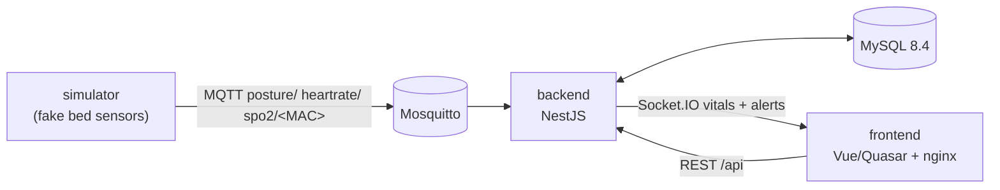
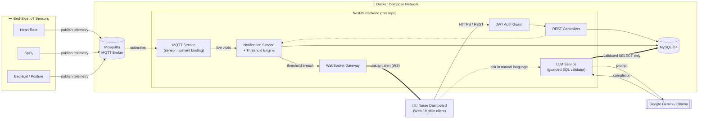

<div align="center">

# 🏥 Smart Ward — Real-Time Bed & Patient Monitoring Platform
### ระบบติดตามเตียงและผู้ป่วยแบบเรียลไทม์สำหรับโรงพยาบาล

**An event-driven, Dockerized NestJS backend that turns raw IoT bed-sensor data into real-time alerts for nursing staff.**
**backend แบบ event-driven ที่รันด้วย Docker แปลงข้อมูลเซนเซอร์เตียง IoT ให้เป็นการแจ้งเตือนแบบเรียลไทม์สำหรับพยาบาล**

[English](#english) · [ภาษาไทย](#thai)


</div>

---

## 🚀 Try it

**In your browser, no install:** [skez.codes/demo/smartbed](https://skez.codes/demo/smartbed/) — the frontend with an in-browser copy of this API and fictional data.

**The real stack, one click:** [](https://codespaces.new/5kez/backend_bedproject?quickstart=1) — when it finishes building, open the forwarded port **8080**.

**Or locally** (Docker):

```bash
git clone https://github.com/5kez/backend_bedproject && cd backend_bedproject
docker compose -f compose.demo.yml up --build
# app:     http://localhost:8080     logins: nurse / admin / superadmin / reception / tech, password demo1234
# Swagger: http://localhost:3000/api/docs
```



| Service | What it is |
|---|---|
| `mysql` | schema generated from the entities ([`db/init/01-schema.sql`](db/init/01-schema.sql)) + fictional seed ([`02-seed.sql`](db/init/02-seed.sql)): 1 hospital, 2 buildings, 3 departments, 12 beds, 13 current and 36 past patients, 40 sensors, 30 days of alert history |
| `mosquitto` | MQTT broker (password auth) |
| `backend` | this API |
| `simulator` | [`simulator/simulate.mjs`](simulator/simulate.mjs) asks the API which sensors sit on which bed and publishes synthetic posture / heart rate / SpO₂ every 3 s, with occasional bed exits, abnormal readings and disconnects so alerts fire |
| `frontend` | built from [frontend_bedproject](https://github.com/5kez/frontend_bedproject), proxies `/api` and `/socket.io` to the backend |

Everything in the seed is invented (names, 13-digit IDs starting with `0`, phone numbers, MAC addresses); dates are relative to when the database is created. `docker compose -f compose.demo.yml down -v` starts over. The Gemini chatbot needs `GEMINI_API_KEY` in your environment. `compose.demo.yml` uses public demo passwords — use `docker-compose.yml` with your own `.env` for anything real.

Regenerating data: `node db/seed/build-seed.mjs` (writes the SQL seed and the frontend demo's `dataset.json`); schema: [`db/dump-schema.sh`](db/dump-schema.sh). CI boots `compose.demo.yml` on every push and checks login, data and live vitals.

**Bugs fixed while building the demo (Nov 2026):** a fresh install had no schema at all; HeartRate/SpO₂ alert texts were swapped (and the LLM summary read swapped channels); `GET /patient/department/:id` was shadowed by another route; inout-trend and sensor-profile endpoints returned 500; deactivated users could still log in; password hashes leaked through three endpoints; NOT NULL columns without defaults made patient/profile/history creation fail; editing a department with beds failed on a foreign key; deleting in-use rows now returns 409 with a readable message; one vitals broadcast per MQTT burst instead of per message.

---

## 👥 Team & My Role · ทีมและบทบาทของผม

This system was built as a **senior project by a team of 7 students** at the Faculty of Informatics, Burapha University (2025).
The original team repository, with the full commit history, is on GitLab: [8bit-bed-sensor/bed-sensor-backend](https://gitlab.com/8bit-bed-sensor/bed-sensor-backend).
This GitHub repository is my **portfolio copy**, re-published with a fresh history — so the first commit contains the whole team's code, not only mine.

**What I built in the original team project (Tham Kaeoket):**
- MQTT ingestion service — per-sensor topic binding by MAC address, SpO2 / heart-rate streams, reconnect & resubscribe
- Socket.IO gateways that push live vitals and alerts to the dashboard
- Notification system — per-patient settings, default templates, alert history
- Password hashing (bcrypt), change-password flow, patient image upload with auto-cleanup
- LSTM posture / bed-exit classifier (trained and tuned myself; 99% accuracy at 25 timesteps)

**What I added in this portfolio copy (Aug 2026):**
- Removed hard-coded secrets and added `.env.example`
- Multi-stage Dockerfile and a Docker Compose stack (app + MySQL + Mosquitto)
- Dead-code clean-up, structured logging and bug fixes
- Deployment on Railway and this README

Other modules (for example the LLM / Text-to-SQL assistant, dashboards and most CRUD modules) were built by my teammates.

> โปรเจกต์นี้เป็นโปรเจกต์จบของทีม 7 คน (คณะวิทยาการสารสนเทศ มหาวิทยาลัยบูรพา) repo นี้เป็นสำเนาสำหรับพอร์ตโฟลิโอของผม ส่วนที่ผมทำระบุไว้ด้านบน ส่วนอื่นเป็นผลงานของเพื่อนร่วมทีม


---

<a id="english"></a>
## 🌐 EN — English

### 📋 Overview

**Smart Ward** is the backend engine for a hospital bed-monitoring system. It ingests **live telemetry from physical bed sensors** (heart rate, SpO₂, bed-exit / posture detection) over **MQTT**, correlates every reading with the correct patient and bed in real time, evaluates it against **configurable clinical thresholds**, and pushes instant alerts to nursing staff over **WebSockets** — closing the loop between "sensor detects a problem" and "a nurse knows about it" in under a second.

On top of the real-time pipeline, it exposes a full **REST + WebSocket API** for hospital operations (patients, beds, departments, buildings, sites, roles, staff), and an **AI assistant layer** (Google Gemini / local Ollama) that lets staff ask questions about ward data in plain language.

> This repository is the **backend only**. It is designed to be consumed by a separate frontend dashboard (web/mobile) via REST and Socket.IO.

### ✨ Key Features & Engineering Highlights

Each item below is a real technical problem this system had to solve — not just a checklist.

| Feature | Technical Challenge Solved |
|---|---|
| **Real-time MQTT sensor ingestion** | Auto-binds thousands of possible `sensor MAC → patient/bed` combinations at boot and on every reassignment, with reconnect/backoff handling so a flaky broker never takes the app down. |
| **Threshold-based alert engine** | Per-patient, per-sensor-type configurable thresholds (heart rate, SpO₂, bed-exit positions) with **debounce + dedup logic** so a single clinical event doesn't spam nurses with duplicate alerts within the same time window. |
| **Real-time WebSocket notifications** | A dedicated Socket.IO gateway broadcasts room-scoped events (by patient/department/floor) so dashboards update instantly without polling. |
| **Guarded AI → SQL pipeline** | Natural-language questions are translated to SQL by an LLM, but the query is **never trusted blindly** — a hand-rolled validator rejects anything that isn't a single, bare `SELECT` statement before it ever touches the database, closing off a prompt-injection → SQL-injection attack path. |
| **JWT authentication & RBAC** | Stateless auth with `bcrypt`-hashed credentials and role/department/site-scoped data access, so a nurse on Floor 2 only ever sees Floor 2. |
| **Multi-tenant dashboards** | Site → Building → Department → Floor scoping is enforced at the query level for every analytics endpoint, not just at the UI. |
| **Production-hardened containerization** | Multi-stage Docker build (build tools never ship to production), a non-root runtime user, and an entrypoint that safely fixes volume permissions before dropping privileges. |
| **Resilient by design** | Global exception filter with structured logging, MySQL connection retry/backoff, and container health checks gate startup ordering (`app` won't start serving traffic until `mysql` + `mosquitto` are actually healthy). |

### 🏗️ System Architecture



**How it flows:** physical sensors publish raw values to **Mosquitto**; the **MQTT Service** binds each MAC address to a patient/bed and keeps an in-memory vitals map; the **Notification Service** evaluates every update against that patient's configured thresholds and, on a breach, both persists a notification and broadcasts it through the **WebSocket Gateway** to any connected dashboard in that room. All CRUD/reporting traffic goes through standard **JWT-guarded REST controllers** backed by **TypeORM/MySQL**. The **LLM Service** sits beside the REST layer as an assistant: it converts natural-language questions into SQL, but every generated query is passed through a strict `SELECT`-only validator before execution.

### 🚀 Local Setup Guide (Docker-first)

This project ships with a **production-ready multi-stage Dockerfile** and a **`docker-compose.yml`** that wires up the app together with its two required backing services — **MySQL** and an **MQTT broker (Mosquitto)** — with health-checked startup ordering, so `docker compose up` gives you a fully working stack with one command.

**Prerequisites:** [Docker Desktop](https://www.docker.com/products/docker-desktop/) (Docker Engine 24+ / Compose v2).

```bash
# 1. Clone the repository
git clone <repository-url>
cd backend_bedproject-main

# 2. Create your local environment file (see the section below)
cp .env.example .env
# → open .env and fill in the required secrets (JWT_SECRET, GEMINI_API_KEY, etc.)

# 3. Build and start the full stack: app + MySQL + Mosquitto
docker compose up --build -d

# 4. Watch it come up
docker compose ps
docker compose logs -f app
```

Once healthy:
| Service | URL |
|---|---|
| REST API | `http://localhost:3000` |
| Swagger / OpenAPI docs | `http://localhost:3000/api/docs` |
| MQTT broker (for sensor devices) | `mqtt://localhost:1883` (authenticated) |

> **Note:** the database container starts **empty** by design — no patient data or schema dumps are baked into the image or the repo (see [`db/init/`](db/init/00-readme.sql)) to avoid ever shipping real patient data in a build artifact. Load your own schema migration/dump into that folder to auto-bootstrap on first run.

To stop everything (and optionally wipe local volumes):
```bash
docker compose down        # stop containers, keep data
docker compose down -v     # stop containers AND remove volumes (fresh start)
```

<details>
<summary><strong>Running without Docker (local Node.js)</strong></summary>

```bash
npm install
npm run build
npm run start:dev   # requires a MySQL instance and MQTT broker reachable via your .env
```
</details>

### 🔑 Environment Variables

All configuration is driven by environment variables — **no secret is ever hardcoded** in the source. Copy the committed template and fill it in:

```bash
cp .env.example .env
```

`.env` is git-ignored on purpose; `.env.example` documents every key with a safe placeholder value so the required configuration surface is always visible in version control without leaking real credentials.

| Variable | Purpose | Required |
|---|---|:---:|
| `DB_HOST` / `DB_PORT` / `DB_USERNAME` / `DB_PASSWORD` / `DB_DATABASE` | MySQL connection (overridden automatically to point at the `mysql` container when run via Docker Compose) | ✅ |
| `JWT_SECRET` / `JWT_EXPIRES_IN` | Signing key & TTL for authentication tokens — app **refuses to boot** without a real secret | ✅ |
| `MQTT_HOST` / `MQTT_PORT` / `MQTT_USERNAME` / `MQTT_PASSWORD` | Connection to the MQTT broker that carries sensor telemetry | ✅ |
| `GEMINI_API_KEY` | Google Gemini API key powering AI patient-summary & natural-language queries | ✅ |
| `OLLAMA_URL` | Optional local LLM endpoint (self-hosted Mistral via Ollama) as an alternative to Gemini | ⬜ |
| `CORS_ORIGIN` / `CORS_METHODS` / `CORS_ALLOWED_HEADERS` | Cross-origin access control for the frontend client | ✅ |
| `SWAGGER_PATH` / `ENABLE_SWAGGER` | Toggle & path for the interactive API docs | ⬜ |
| `MYSQL_ROOT_PASSWORD` / `MYSQL_DATABASE` / `MYSQL_USER` / `MYSQL_PASSWORD` | **Docker Compose only** — provisions a least-privilege MySQL user for the local `mysql` container | ✅ (Docker) |

### 📂 Project Structure

```
src/
├── auth/                # JWT authentication & guards
├── bed/                 # Bed inventory & bed-assignment lifecycle
├── mqtt/                # Sensor ↔ patient/bed binding, live vitals ingestion
├── notification/        # Threshold engine + WebSocket alert gateway
├── notification-setting/# Per-patient/sensor alert configuration
├── llm/                  # AI patient summary + guarded NL→SQL assistant
├── patient/              # Patient records & real-time patient gateway
├── dashboard/            # Analytics & reporting endpoints
├── common/filters/       # Global exception handling
└── ...                   # buildings, departments, floors, sites, roles, users, etc.
```

### 🧪 Testing & Code Quality

```bash
npm run test        # unit tests (Jest)
npm run test:cov     # coverage report
npm run lint         # ESLint + Prettier (0 errors enforced)
```

The codebase is held to a strict, type-checked ESLint configuration (`typescript-eslint` recommended-type-checked ruleset) — no implicit `any` leaks across service boundaries, and every raw SQL result is explicitly typed at the query site.

### 📄 License

Private / proprietary. All rights reserved.

---

<a id="thai"></a>
## 🇹🇭 ภาษาไทย

### 📋 ภาพรวมโครงการ

**Smart Ward** คือระบบ backend สำหรับระบบติดตามเตียงผู้ป่วยในโรงพยาบาล ทำหน้าที่รับข้อมูล**เซนเซอร์ IoT แบบเรียลไทม์**จากเตียงผู้ป่วยจริง (อัตราการเต้นของหัวใจ, ระดับออกซิเจนในเลือด (SpO₂), การลุกออกจากเตียง/ท่านั่ง) ผ่านโปรโตคอล **MQTT** เชื่อมโยงข้อมูลกับผู้ป่วยและเตียงที่ถูกต้องแบบทันที ประเมินผลตาม**เกณฑ์แจ้งเตือนทางคลินิกที่ตั้งค่าได้** และส่งการแจ้งเตือนไปยังพยาบาลผ่าน **WebSocket** ภายในเวลาไม่ถึงหนึ่งวินาที — ปิด gap ระหว่าง "เซนเซอร์ตรวจพบความผิดปกติ" กับ "พยาบาลรู้ทันที"

นอกเหนือจากระบบเรียลไทม์ ยังมี **REST + WebSocket API** ครบวงจรสำหรับการบริหารจัดการโรงพยาบาล (ผู้ป่วย เตียง แผนก อาคาร สถานที่ สิทธิ์การใช้งาน พนักงาน) และ **ผู้ช่วย AI** (Google Gemini / Ollama ภายในเครื่อง) ที่ให้เจ้าหน้าที่ถามข้อมูลของหอผู้ป่วยด้วยภาษาธรรมดาได้

> Repository นี้เป็นส่วน **backend เท่านั้น** ออกแบบมาให้ frontend dashboard (เว็บ/มือถือ) แยกต่างหากเรียกใช้งานผ่าน REST และ Socket.IO

### ✨ ฟีเจอร์หลักและจุดเด่นทางเทคนิค

แต่ละรายการด้านล่างคือปัญหาทางเทคนิคจริงที่ระบบนี้ต้องแก้ ไม่ใช่แค่รายการฟีเจอร์ทั่วไป

| ฟีเจอร์ | ปัญหาทางเทคนิคที่แก้ไข |
|---|---|
| **รับข้อมูลเซนเซอร์ผ่าน MQTT แบบเรียลไทม์** | จับคู่ `MAC address ของเซนเซอร์ → ผู้ป่วย/เตียง` ที่เป็นไปได้นับพันคู่โดยอัตโนมัติตั้งแต่แอปเริ่มทำงาน และทุกครั้งที่มีการย้ายเตียง พร้อมระบบ reconnect/backoff ที่ทำให้ broker ที่หลุดการเชื่อมต่อไม่ทำให้แอปล่มตาม |
| **ระบบแจ้งเตือนตามเกณฑ์ (Threshold Engine)** | ตั้งค่าเกณฑ์แจ้งเตือนได้ต่อผู้ป่วยและต่อชนิดเซนเซอร์ (หัวใจ, SpO₂, ตำแหน่งการลุกจากเตียง) พร้อม **logic debounce และป้องกันการแจ้งเตือนซ้ำ** ไม่ให้เหตุการณ์ทางคลินิกเดียวส่งแจ้งเตือนซ้ำซ้อนรัว ๆ ในช่วงเวลาเดียวกัน |
| **การแจ้งเตือนแบบเรียลไทม์ผ่าน WebSocket** | Socket.IO gateway เฉพาะทาง กระจาย event แบบจำกัดขอบเขตตาม room (ตามผู้ป่วย/แผนก/ชั้น) ทำให้ dashboard อัปเดตทันทีโดยไม่ต้อง polling |
| **สาย pipeline AI → SQL ที่มีการป้องกัน** | คำถามภาษาธรรมชาติถูกแปลงเป็น SQL โดย LLM แต่ **ไม่เชื่อผลลัพธ์แบบไม่มีการตรวจสอบ** — มี validator ที่เขียนขึ้นเองปฏิเสธคำสั่งใดๆที่ไม่ใช่ `SELECT` เดี่ยวล้วน ๆ ก่อนจะรันกับฐานข้อมูลจริง ปิดช่องโหว่ prompt-injection ที่จะนำไปสู่ SQL-injection |
| **การยืนยันตัวตนด้วย JWT และ RBAC** | ระบบยืนยันตัวตนแบบ stateless เข้ารหัสรหัสผ่านด้วย `bcrypt` และจำกัดขอบเขตข้อมูลตามสิทธิ์/แผนก/สถานที่ ทำให้พยาบาลชั้น 2 เห็นข้อมูลเฉพาะชั้น 2 เท่านั้น |
| **Dashboard แบบ Multi-tenant** | บังคับขอบเขตข้อมูลระดับ สถานที่ → อาคาร → แผนก → ชั้น ที่ระดับ query จริง ไม่ใช่แค่ซ่อนไว้ที่ฝั่ง UI |
| **Containerization ระดับ production** | Docker แบบ multi-stage build (เครื่องมือสำหรับ build ไม่ถูกส่งไปยัง production เลย) รันด้วย non-root user และมี entrypoint ที่แก้ไขสิทธิ์ของ volume อย่างปลอดภัยก่อนลดสิทธิ์ลง |
| **ออกแบบให้ทนทานต่อความผิดพลาด** | มี global exception filter พร้อม structured logging, MySQL connection retry/backoff, และ container health check ที่ควบคุมลำดับการ start (`app` จะไม่เริ่มรับ request จนกว่า `mysql` และ `mosquitto` จะพร้อมจริง) |

### 🏗️ ภาพรวมสถาปัตยกรรมระบบ

ดูแผนภาพ Mermaid ในหัวข้อ **System Architecture** ด้านบน (ใช้ร่วมกันทั้งสองภาษา)

**การทำงานโดยสรุป:** เซนเซอร์จริงส่งข้อมูลดิบไปยัง **Mosquitto**; **MQTT Service** จับคู่ MAC address กับผู้ป่วย/เตียง และเก็บค่าสัญญาณชีพล่าสุดไว้ใน memory; **Notification Service** ตรวจสอบค่าทุกครั้งที่อัปเดตกับเกณฑ์ที่ตั้งไว้ของผู้ป่วยรายนั้น และเมื่อเกินเกณฑ์ จะบันทึกการแจ้งเตือนและกระจายผ่าน **WebSocket Gateway** ไปยัง dashboard ที่เชื่อมต่ออยู่ใน room นั้นทันที ส่วนงาน CRUD/รายงานทั้งหมดผ่าน **REST controller ที่มี JWT guard** เชื่อมกับ **TypeORM/MySQL** และ **LLM Service** ทำหน้าที่เป็นผู้ช่วยควบคู่กับ REST layer: แปลงคำถามภาษาธรรมชาติเป็น SQL แต่ทุกคำสั่งที่สร้างขึ้นต้องผ่าน validator ที่ยอมรับเฉพาะ `SELECT` เท่านั้นก่อนรันจริง

### 🚀 คู่มือการติดตั้งใช้งานบนเครื่อง Local (เน้น Docker)

โปรเจกต์นี้มาพร้อม **Dockerfile แบบ multi-stage พร้อมใช้งานระดับ production** และ **`docker-compose.yml`** ที่เชื่อมแอปเข้ากับ backing service ที่จำเป็นทั้งสองตัว คือ **MySQL** และ **MQTT broker (Mosquitto)** พร้อมลำดับการ start ที่ควบคุมด้วย health check ทำให้แค่รัน `docker compose up` ครั้งเดียวก็ได้ stack ที่ใช้งานได้ครบ

**สิ่งที่ต้องมีก่อน:** [Docker Desktop](https://www.docker.com/products/docker-desktop/) (Docker Engine 24+ / Compose v2)

```bash
# 1. Clone repository
git clone <repository-url>
cd backend_bedproject-main

# 2. สร้างไฟล์ environment ของตัวเอง (ดูรายละเอียดหัวข้อด้านล่าง)
cp .env.example .env
# → เปิดไฟล์ .env แล้วกรอกค่า secret ที่จำเป็น (JWT_SECRET, GEMINI_API_KEY, ฯลฯ)

# 3. Build และเริ่มระบบทั้งหมด: app + MySQL + Mosquitto
docker compose up --build -d

# 4. ตรวจสอบสถานะ
docker compose ps
docker compose logs -f app
```

เมื่อระบบพร้อมใช้งาน:
| Service | URL |
|---|---|
| REST API | `http://localhost:3000` |
| เอกสาร API (Swagger/OpenAPI) | `http://localhost:3000/api/docs` |
| MQTT broker (สำหรับอุปกรณ์เซนเซอร์) | `mqtt://localhost:1883` (ต้อง authenticate) |

> **หมายเหตุ:** container ของฐานข้อมูลจะเริ่มต้นแบบ**เปล่า**โดยตั้งใจ — ไม่มีข้อมูลผู้ป่วยหรือ schema dump ฝังอยู่ใน image หรือ repository เลย (ดู [`db/init/`](db/init/00-readme.sql)) เพื่อไม่ให้มีข้อมูลผู้ป่วยจริงหลุดไปอยู่ใน build artifact โดยไม่ตั้งใจ หากต้องการ bootstrap อัตโนมัติ ให้นำไฟล์ schema/migration ของคุณเองไปวางไว้ในโฟลเดอร์นั้น

หากต้องการหยุดระบบ (และล้างข้อมูล local ถ้าต้องการ):
```bash
docker compose down        # หยุด container แต่เก็บข้อมูลไว้
docker compose down -v     # หยุด container และลบ volume ทั้งหมด (เริ่มใหม่หมด)
```

<details>
<summary><strong>การรันแบบไม่ใช้ Docker (Node.js บนเครื่อง local)</strong></summary>

```bash
npm install
npm run build
npm run start:dev   # ต้องมี MySQL instance และ MQTT broker ที่เข้าถึงได้ตามค่าใน .env
```
</details>

### 🔑 การตั้งค่า Environment Variables

การตั้งค่าทั้งหมดของระบบมาจาก environment variables — **ไม่มี secret ใดถูก hardcode ไว้ในซอร์สโค้ดเด็ดขาด** ให้คัดลอกไฟล์ตัวอย่างที่ commit ไว้แล้วกรอกค่าจริง:

```bash
cp .env.example .env
```

ไฟล์ `.env` ถูกตั้งใจให้ git ไม่ track (อยู่ใน `.gitignore`) ส่วนไฟล์ `.env.example` จะระบุทุก key พร้อมค่า placeholder ที่ปลอดภัย เพื่อให้เห็นภาพรวมของ configuration ที่จำเป็นได้จาก version control โดยไม่หลุดข้อมูลจริงออกไป

| ตัวแปร | หน้าที่ | จำเป็น |
|---|---|:---:|
| `DB_HOST` / `DB_PORT` / `DB_USERNAME` / `DB_PASSWORD` / `DB_DATABASE` | การเชื่อมต่อ MySQL (จะถูก override ให้ชี้ไปที่ container `mysql` โดยอัตโนมัติเมื่อรันผ่าน Docker Compose) | ✅ |
| `JWT_SECRET` / `JWT_EXPIRES_IN` | Secret key สำหรับเซ็น token และอายุการใช้งาน — **แอปจะไม่ยอม start** ถ้าไม่มีค่า secret จริง | ✅ |
| `MQTT_HOST` / `MQTT_PORT` / `MQTT_USERNAME` / `MQTT_PASSWORD` | การเชื่อมต่อ MQTT broker ที่รับส่งข้อมูลเซนเซอร์ | ✅ |
| `GEMINI_API_KEY` | API key ของ Google Gemini สำหรับสรุปข้อมูลผู้ป่วยด้วย AI และตอบคำถามภาษาธรรมชาติ | ✅ |
| `OLLAMA_URL` | Endpoint ของ LLM ภายในเครื่อง (Mistral ผ่าน Ollama) เป็นตัวเลือกเสริมแทน Gemini | ⬜ |
| `CORS_ORIGIN` / `CORS_METHODS` / `CORS_ALLOWED_HEADERS` | การควบคุมการเข้าถึงข้าม origin สำหรับ frontend client | ✅ |
| `SWAGGER_PATH` / `ENABLE_SWAGGER` | เปิด/ปิด และกำหนด path ของเอกสาร API แบบ interactive | ⬜ |
| `MYSQL_ROOT_PASSWORD` / `MYSQL_DATABASE` / `MYSQL_USER` / `MYSQL_PASSWORD` | **ใช้เฉพาะ Docker Compose** — สร้าง user MySQL แบบสิทธิ์น้อยที่สุดสำหรับ container `mysql` ในเครื่อง local | ✅ (Docker) |

### 📂 โครงสร้างโปรเจกต์

```
src/
├── auth/                 # การยืนยันตัวตนด้วย JWT และ guard
├── bed/                  # คลังเตียงและวงจรการจับคู่เตียง-ผู้ป่วย
├── mqtt/                 # การจับคู่เซนเซอร์กับผู้ป่วย/เตียง และรับค่าสัญญาณชีพแบบเรียลไทม์
├── notification/         # ระบบตรวจสอบเกณฑ์ + WebSocket gateway สำหรับแจ้งเตือน
├── notification-setting/ # ค่าตั้งการแจ้งเตือนต่อผู้ป่วย/ชนิดเซนเซอร์
├── llm/                   # ผู้ช่วย AI สรุปข้อมูลผู้ป่วย + แปลงภาษาธรรมชาติเป็น SQL (มีการตรวจสอบ)
├── patient/               # ข้อมูลผู้ป่วยและ gateway แบบเรียลไทม์
├── dashboard/             # Endpoint สำหรับวิเคราะห์ข้อมูลและรายงาน
├── common/filters/        # การจัดการ exception แบบรวมศูนย์
└── ...                    # อาคาร, แผนก, ชั้น, สถานที่, สิทธิ์การใช้งาน, ผู้ใช้งาน ฯลฯ
```

### 🧪 การทดสอบและคุณภาพโค้ด

```bash
npm run test        # unit test (Jest)
npm run test:cov     # รายงาน code coverage
npm run lint         # ESLint + Prettier (บังคับ 0 error)
```

โค้ดทั้งหมดอยู่ภายใต้มาตรฐาน ESLint ที่เข้มงวดและตรวจสอบ type (`typescript-eslint` recommended-type-checked) — ไม่มีการหลุดของ `any` แบบไม่ตั้งใจข้ามขอบเขต service และผลลัพธ์จาก raw SQL query ทุกจุดถูกกำหนด type อย่างชัดเจน

### 📄 สัญญาอนุญาต

Private / proprietary สงวนสิทธิ์ทั้งหมด
